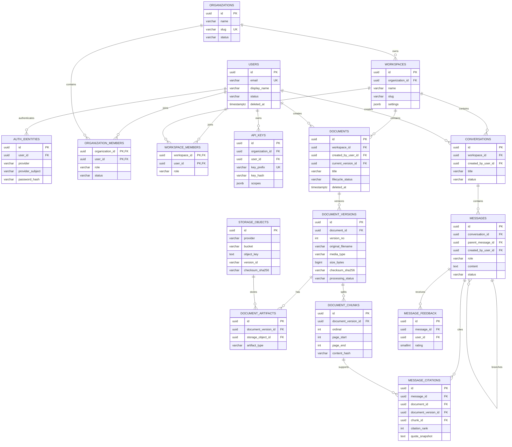
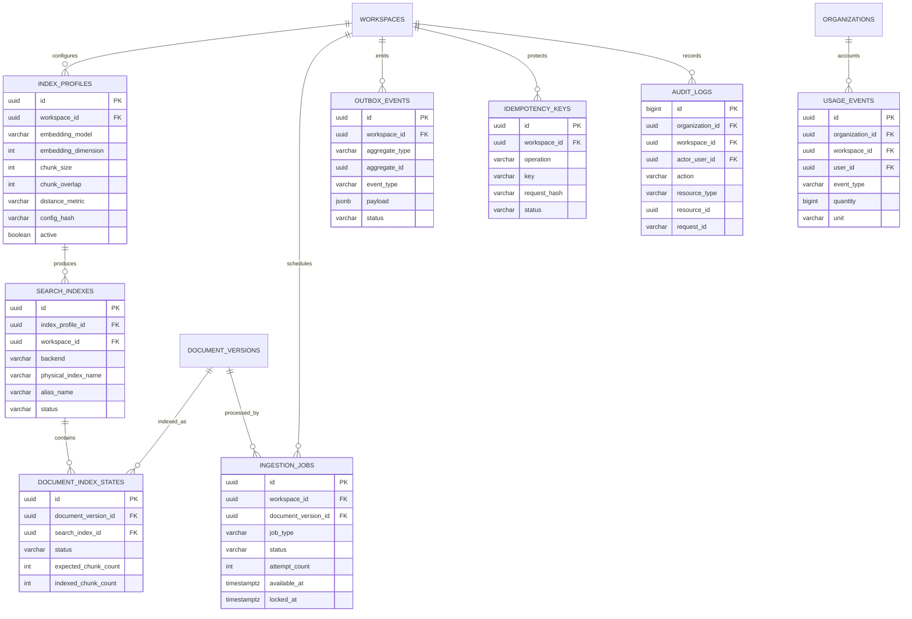

# SecureDoc Agent PostgreSQL ERD

PostgreSQL은 사용자, 권한, 문서 상태, 대화, 인덱싱 작업의 기준 데이터(Source of Truth)입니다. 원본 파일은 Object Storage에, 검색용 본문과 벡터는 OpenSearch 또는 FAISS에 저장합니다.

## 저장소 경계

| 저장소 | 저장 데이터 | 성격 |
|---|---|---|
| PostgreSQL | 사용자, 권한, 문서/버전 메타데이터, 작업 상태, 대화, 인용, 감사 로그 | 기준 데이터 |
| OCI Object Storage/S3 | 원본 문서, 추출 텍스트, 미리보기, OCR 결과 | 원본·대용량 artifact |
| OpenSearch | 청크 본문, 임베딩, 검색 필터 | 재구축 가능한 검색 인덱스 |
| FAISS | 로컬 개발 및 롤백용 벡터 인덱스 | 재구축 가능한 검색 인덱스 |

## 사용자·문서·대화 ERD



## 인덱싱·운영 ERD



## 핵심 설계 규칙

1. 모든 서비스 데이터는 `workspace_id`를 tenant 경계로 사용합니다.
2. 파일명 대신 UUIDv7 문서 ID를 사용합니다.
3. `documents`는 논리 문서, `document_versions`는 실제 업로드 버전입니다.
4. Object Storage 객체는 `storage_objects`에서 provider, bucket, key, checksum, version을 추적합니다.
5. 청크 본문과 임베딩은 검색 저장소에 두고 PostgreSQL에는 위치와 hash를 저장합니다.
6. 외부 저장소와의 일관성은 `ingestion_jobs`와 `outbox_events`로 복구합니다.
7. 인용에는 파일명, 페이지, 인용문 snapshot을 남겨 원본 삭제 후에도 감사할 수 있게 합니다.
8. 문서는 soft delete하고 OpenSearch와 Object Storage 정리가 끝난 뒤 보존 정책에 따라 hard delete합니다.
9. `index_profiles.config_hash`가 바뀌면 새 물리 인덱스를 구축하고 alias를 교체합니다.
10. OpenSearch 쿼리에는 반드시 `workspace_id` 필터를 포함합니다.

## 상태 흐름

```text
문서 버전
PENDING → UPLOADING → UPLOADED → PARSING → CHUNKING
        → EMBEDDING → INDEXING → READY
                              ↘ FAILED

인덱싱 작업
PENDING → RUNNING → SUCCEEDED
             ├──→ RETRY_WAIT → RUNNING
             ├──→ FAILED
             └──→ CANCELLED

검색 인덱스
BUILDING → VALIDATING → ACTIVE → RETIRED
                    ↘ FAILED
```

## 실행과 마이그레이션

Windows 네이티브 설치는 관리자 PowerShell에서 아래 스크립트 하나로 수행합니다.

```powershell
.\scripts\install_postgresql.ps1
```

스크립트는 PostgreSQL 17 설치, localhost 전용 바인딩, 애플리케이션 역할과 DB 생성, Alembic 적용, 기본 tenant 생성, 기존 문서 메타데이터 이관 및 검증을 순서대로 수행합니다. 비밀번호는 `%APPDATA%\postgresql\pgpass.conf`에 저장하며 저장소에는 기록하지 않습니다.

Docker 방식은 `.env`의 `POSTGRES_PASSWORD`와 `DATABASE_URL` 비밀번호를 동일하게 설정하고 `DATABASE_ENABLED=true`로 변경합니다. 기존 테스트와 파일 기반 실행은 기본값 `false`를 사용합니다.

```powershell
docker compose up -d postgres
.\.venv\Scripts\python.exe -m alembic upgrade head
.\.venv\Scripts\python.exe -m database.bootstrap
.\.venv\Scripts\python.exe -m database.import_legacy
.\.venv\Scripts\python.exe -m database.verify
```

SQL을 DB에 적용하지 않고 확인하려면:

```powershell
.\.venv\Scripts\python.exe -m alembic upgrade head --sql
```

## 변경 규칙

- `database/schema/0001_initial.sql`은 최초 baseline이므로 수정하지 않습니다.
- 이후 변경은 새 Alembic revision으로 추가합니다.
- 운영 DB에서 `Base.metadata.create_all()`을 사용하지 않습니다.
- downgrade는 데이터 삭제를 포함할 수 있으므로 운영 환경에서 백업과 승인 없이 실행하지 않습니다.
- 감사 로그와 사용량 이벤트가 커지면 월 단위 partitioning을 별도 migration으로 추가합니다.

## 현재 런타임 연결 범위

- 문서 목록과 상세 조회는 PostgreSQL의 현재 `READY` 버전을 사용합니다.
- 파일 업로드와 API ingest는 문서, 버전, LOCAL storage object, artifact, ingestion job을 하나의 DB 트랜잭션으로 등록합니다.
- API 프로세스의 동기 실행 또는 `python -m database.worker`가 대기 작업을 처리합니다.
- 작업 성공 시 FAISS 갱신, 청크 hash/ordinal 기록, 문서 버전 `READY`, 작업 `SUCCEEDED`가 반영됩니다.
- 문서 삭제는 `DELETING` 상태를 거쳐 로컬 원본과 FAISS를 갱신한 뒤 soft delete됩니다.
- 질문 성공 시 conversation, USER/ASSISTANT message, citation snapshot이 저장됩니다.
- 기본값은 로컬 파일과 FAISS이며, 설정을 `MINIO`/`S3`와 `OPENSEARCH`로 바꾸면 Outbox 기반 원본 저장과 alias 기반 검색 인덱스를 사용합니다.
- 외부 Object Storage 작업은 `ops.outbox_events`에 같은 트랜잭션으로 기록되고 worker가 재시도합니다.
- 여러 API/worker 프로세스의 인덱스 갱신은 workspace별 PostgreSQL advisory lock으로 직렬화됩니다.
