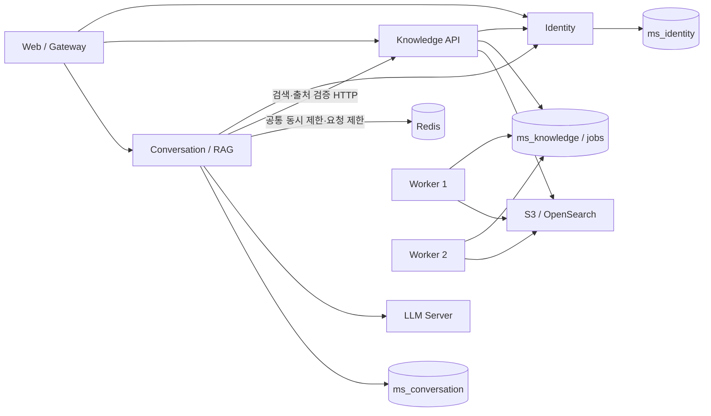

# 마이크로서비스 전환과 운영

기본 Compose를 인증·사용자, 문서·검색, 대화·RAG의 독립 서비스로 전환했습니다.
PostgreSQL 서버는 한 대이고 `svc_identity`, `svc_knowledge`, `svc_conversation` 계정이
각각 `ms_identity`, `ms_knowledge`, `ms_conversation`만 소유합니다. 앱에는 관리자
PostgreSQL 비밀번호를 전달하지 않습니다. 최초 권한 생성 전용 bootstrap job만 사용합니다.

## 변경 이유와 효과

| 이전 | 변경 | 이유·효과 |
|---|---|---|
| 하나의 API와 backend 이미지 | 업무별 Dockerfile·requirements·이미지 태그·진입점 | 대화 로직만 패치할 때 인증·문서 이미지를 재빌드하지 않음 |
| 공유 ORM, 타 스키마 JOIN·FK | 자기 SQL migration·전용 DB 계정, cross-schema 참조 제거 | 다른 팀/서비스의 테이블 변경이 직접 전파되지 않음 |
| RAG가 검색 저장소·임베딩에 직접 접근 | v1 HTTP 검색·출처 검증 | 검색 엔진·모델 변경을 knowledge 안에서 수행 |
| 서비스 간 원본 파일 볼륨 의존 | knowledge 내부 DB staging + S3 | 대화·인증은 파일 경로나 저장소 자격 증명 불필요 |
| 업무 요청과 무거운 처리 결합 | knowledge 전용 Worker·내구성 큐 | 문서 업로드 요청과 임베딩 처리량을 별도로 확장 |
| 최신 사용자 권한 확인을 DB JOIN으로 수행 | identity의 인증 API로 확인 | 사용자 DB·서명 키를 다른 서비스에 배포하지 않음 |
| 변경 후 삭제된 검색 결과가 남을 가능성 | READY 필터 + 생성 후 출처 재검증 | 외부 삭제 지연 중에도 신규 답변 근거에서 제외 |
| gateway가 단일 API에 의존 | 경로별 라우팅·요청 시 DNS 확인 | 한 서비스를 재시작해도 나머지 경로와 웹을 계속 제공 |
| 기존 단일 API 지표 | 서비스별 요청 수·오류율·가용성 알람 | 어느 서비스에서 장애가 나는지 구분 |

모든 의존성이 없어지는 것은 아닙니다. 인증 API 장애는 보호된 요청을 차단하고,
knowledge 장애는 RAG 검색을 막습니다. 대화/LLM 장애가 문서 조회·사용자 관리를
중단시키지는 않습니다. 계약 변경은 호환 가능한 방식으로 배포해야 합니다.

## 처음 실행

```powershell
.\.venv\Scripts\python.exe tools/prepare_microservices_env.py
# 이미 생성된 경우 이 명령은 덮어쓰지 않습니다.
# 기존 환경에 Redis 등 새 항목만 추가할 때:
.\.venv\Scripts\python.exe tools/prepare_microservices_env.py --upgrade
# .env.microservices에서 관리자 이메일·비밀번호와 LLM 연결 값을 확인합니다.
docker compose --env-file .env.microservices config --quiet
docker compose --env-file .env.microservices up -d --build
docker compose --env-file .env.microservices ps
```

웹은 `http://localhost:8000`입니다. 새 환경은 PostgreSQL `55432`, S3 `19000`,
OpenSearch `19200`의 localhost 전용 포트를 사용합니다. 기존 볼륨과 구분되는
`micro_*` 새 볼륨을 사용합니다. 생성된 `.env.microservices`는 Git에서 제외되며
비밀번호는 생성 로그에 출력하지 않습니다. 기본 설정은 로컬 개발용입니다.
외부 운영은 TLS, S3/OpenSearch 인증, 비밀 관리, 외부 LLM 용량을 별도 구성해야 합니다.

## 개별 패치

대화 서비스 코드만 변경한 예:

```powershell
docker compose --env-file .env.microservices build conversation
docker compose --env-file .env.microservices up -d --no-deps conversation
docker compose --env-file .env.microservices logs --tail 100 conversation
```

knowledge 코드 변경 시 API와 같은 업무 서비스 Worker를 함께 교체합니다.

```powershell
docker compose --env-file .env.microservices build knowledge
docker compose --env-file .env.microservices up -d --no-deps knowledge knowledge-worker
```

릴리스마다 `.env.microservices`의 해당 `*_IMAGE_TAG`를 올리고 이전 이미지를 보존합니다.
롤백은 태그를 이전 값으로 바꾼 뒤 `up -d --no-deps --no-build <service>`입니다.
DB migration은 자동 역실행하지 않습니다. 컬럼 추가 → 양쪽 버전 지원 → 이전 코드 제거의
순서로 변경하여 이전 이미지가 새 스키마에서도 동작하게 유지해야 합니다.

`KNOWLEDGE_REPLICAS`, `WORKER_REPLICAS`, `CONVERSATION_REPLICAS`로 확장합니다.
Worker 기본값은 2개입니다. 각 프로세스가 임베딩 모델을 로드하므로 메모리에 맞춰 조절합니다.
LLM 동시 제한은 Redis의 같은 `LLM_CAPACITY_POOL`을 사용하는 모든 conversation replica에
공통 적용됩니다. 상세 설정과 검증 순서는 [Redis·Worker 운영](#redis와-worker-병렬-처리)을 참고하세요.
OpenAI API를 사용하면 `LLM_PROVIDER=openai`로 설정하여 Ollama 전용 옵션을 보내지 않습니다.
임베딩 모델·분할 설정을 바꾸면 인덱스 이름도 분리됩니다. 새 설정으로 재색인을 완료한 뒤
검색 트래픽을 전환해야 합니다. DB migration과 마찬가지로 모델 변경도 배포 순서를 계획합니다.

## 기존 데이터 이관

레거시 구성은 `compose.legacy.yaml`에 보존했습니다. 이 파일과 기존 `.env`를 사용하면
기존 backend를 실행할 수 있습니다. 새 구성은 기존 데이터가 자동으로 나타나지 않습니다.
전환 전 DB·원본을 백업하고, 기존 서비스의 쓰기를 중단한 상태에서 이관합니다.
실행 중 이중 쓰기나 자동 cutover는 제공하지 않습니다.

1. 새 PostgreSQL과 bootstrap·세 서비스를 실행하여 새 migration을 준비합니다.
2. 새 Worker를 잠시 중지합니다. bootstrap 관리자 이메일은 기존 사용자 이메일과
   다른 주소를 사용합니다. 충돌하면 이관 도구가 중단합니다.
3. 환경변수에 기존 DB의 읽기 가능한 DSN `LEGACY_DATABASE_URL`과 새 DB의 관리자 DSN
   `MICROSERVICES_ADMIN_DATABASE_URL`을 지정합니다. 비밀번호를 명령 이력에 남기지 않도록
   비밀 관리 도구나 현재 셸 환경으로 제공합니다.
4. 먼저 검사한 다음 적용합니다.

동일 호스트에서는 기존 Gateway와 새 Gateway가 모두 8000 포트를 사용합니다.
이관 준비 중에는 새 Gateway를 제외하고 필요한 서비스만 먼저 실행합니다.

```powershell
docker compose --env-file .env.microservices up -d --build postgres bootstrap-db identity knowledge conversation minio opensearch redis
# 원본 DB와 저장소는 켜 두고, 기존 환경의 쓰기 처리만 중단합니다.
docker compose -f compose.legacy.yaml --env-file .env stop gateway api worker
```

```powershell
.\.venv\Scripts\python.exe tools/migrate_legacy_services.py
.\.venv\Scripts\python.exe tools/migrate_legacy_services.py --apply
docker compose --env-file .env.microservices start knowledge-worker
```

처음부터 새 Worker를 실행하지 않았다면 `start` 대신
`docker compose --env-file .env.microservices up -d knowledge-worker`로 생성합니다.
색인·로그인·기록 검증 후 `docker compose --env-file .env.microservices up -d --build gateway`로
새 웹 진입점을 실행합니다.

기존 원본 위치는 `--source-dir`, 기존 저장소 설정은 `--legacy-env`로 지정할 수 있습니다.
컨테이너 URL을 호스트에서 읽어야 하면 `LEGACY_OBJECT_STORAGE_ENDPOINT_URL`로 대체합니다.
모든 원본의 checksum을 먼저 검증하고, 원본이 없거나 checksum이 다르면 중단합니다.
기존 DB는 read-only transaction으로 읽고 수정하지 않습니다. 새 대상 전체 이관은 한
트랜잭션으로 수행하고 같은 ID를 재이관하면 중복 생성하지 않습니다.

사용자·현재 권한·활성 문서·활성 대화·완료 메시지·인용 스냅샷을 보존합니다. 원본은 새
knowledge 큐로 다시 저장·색인합니다. 삭제/보관 문서, 과거 문서 버전, feedback, 운영
작업 이력, API 키는 자동 이관 대상이 아닙니다. 필요하면 별도 보존·이관해야 합니다.
기존 JWT는 새 issuer와 서명 체계에서 유효하지 않으므로 다시 로그인합니다.
검증 후 Gateway 트래픽을 새 구성으로 전환합니다. 이전 환경으로 롤백하면 전환 후
새 환경에서 생성된 쓰기는 자동으로 역이관되지 않습니다.

## 확인과 테스트

```powershell
.\.venv\Scripts\python.exe -m pytest microservices/tests -q
```

DB 통합 테스트는 `MICROSERVICES_TEST_DSN`을 **이름이 `_test`로 끝나는 폐기 가능한 DB**에
지정해야 합니다. 관리자 계정으로 테스트 스키마를 만들고 초기화하므로 운영 DB를 사용하지
않습니다. 지정하지 않으면 DB 테스트는 skip하고 정적 서비스 경계·parser만 확인합니다.
통합 테스트는 실제 PostgreSQL 권한·RLS·migration·큐를 사용하고 S3/OpenSearch/LLM은
결정적인 adapter 대역을 사용합니다. 실제 모델·스토리지 검증을 대체하지 않습니다.
`tools/smoke_microservices.py`는 같은 테스트 DB에 세 개의 실제 HTTP 프로세스를 실행하고
독립 기동·로그인·문서 큐 등록·대화 조회·장애 격리를 확인한 뒤 프로세스를 종료합니다.
이번 실행 결과와 미검증 항목은 [검증 기록](microservices-validation.md)에 정리했습니다.

각 컨테이너의 `/health`는 프로세스 상태, `/ready`는 자기 migration·DB 준비 상태입니다.
conversation의 `/ready`는 Redis 연결도 확인합니다. knowledge는 API 기동 중 임베딩 모델을
미리 로드하여 첫 검색에서 모델 초기화로 의존성 timeout이 발생하는 것을 막습니다.
Compose와 Kubernetes의 모델 초기 기동 유예는 10분이며, 다운로드 속도에 따라 조절합니다.
adapter 대역을 사용하는 `APP_ENVIRONMENT=test`에서는 모델 사전 로딩을 생략합니다.
Gateway의 `/api/v1/ready`는 knowledge DB 상태만 나타내며 전체 의존성 집계가 아닙니다.
실제 로그인·업로드·Worker READY·질문 시나리오로 전체 환경을 검증해야 합니다.
`monitoring` profile은 세 서비스 `/metrics`를 직접 수집합니다. knowledge는 작업 상태별
건수와 가장 오래된 미완료 작업의 대기 시간도 제공합니다. 서비스 중단·오류율·큐 정체·
최종 실패 알람을 포함합니다. LLM 지연·DB pool 세부 지표와 운영 알림 수신자는 추가 작업입니다.

Kubernetes는 `infra/kubernetes/secure-doc-agent.yaml`의 새 서비스 Deployment/Service를
사용합니다. PostgreSQL·S3·OpenSearch는 별도 준비하고 파일에 명시된 세 서비스 Secret과
`redis-secrets`의 `REDIS_PASSWORD`를
생성해야 합니다. 역할 생성과 schema bootstrap은 먼저 실행해야 합니다.
기존 Kubernetes 예시는 `.legacy.yaml`로 보존했습니다.

## Redis와 Worker 병렬 처리

재색인은 문서별로 파싱·임베딩 후 비활성 색인에 기록하고 청크·벡터 메모리를 해제합니다.
전체 문서의 임베딩을 메모리에 모으지 않으며, 작업 중간에 실패하면 준비 중인 색인을 정리하고
기존 검색 색인을 유지합니다. 개별 문서의 파싱·임베딩 메모리는 여전히 필요하므로 큰 문서는
Worker 메모리와 업로드 크기 제한을 함께 고려해야 합니다.

`POST /api/v1/index/update`는 기존 응답에 `job_id`를 추가합니다.
관리자는 `GET /api/v1/index/jobs/{job_id}`로 자기 workspace의 재색인 작업만 조회할 수 있습니다.
응답에는 `status`, `attempts`, `error_code`, `generation_before`, `generation_after`,
`active_generation`이 포함됩니다. `DONE`일 때 실제 검색 색인 세대도 확인합니다.
전체 검증 도구는 요청한 작업의 `DONE`, 변경된 세대, 실제 활성 세대 일치를 모두 요구합니다.
`/api/v1/index/status`의 `ready`만으로 재색인 성공을 판단하지 않습니다.

출처 검증 모델은 검색 결과의 문서 번호만 반환하고, 서버가 검증한 번호를 원래 파일명으로
매핑합니다. 모델이 긴 파일명을 잘못 복사해 올바른 출처가 탈락하는 문제를 방지하며,
범위를 벗어난 번호·문자열·잘못된 JSON은 출처로 인정하지 않습니다.



Redis는 업무 DB나 작업 큐를 대체하지 않습니다. conversation의 공통 제어만 담당하며,
knowledge의 작업 큐는 기존 PostgreSQL 트랜잭션·lease·재시도를 유지합니다.

| 항목 | 기본값·동작 | 효과 |
|---|---|---|
| `CAPACITY_BACKEND` | `redis` | replica 증가 시에도 하나의 공통 제한 사용 |
| `LLM_MAX_CONCURRENCY` | 1 | 같은 pool의 RAG 실행 수 제한 |
| `LLM_CAPACITY_POOL` | `default` | 같은 모델 서버를 쓰는 replica는 같은 값·제한 설정 사용 |
| `LLM_SLOT_TTL_SECONDS` | 900, TTL의 1/3마다 갱신 | 종료된 프로세스의 슬롯을 만료 처리 |
| `LLM_QUEUE_TIMEOUT_SECONDS` | 5 | 대기 한도 초과 시 429 |
| `RAG_RATE_LIMIT_REQUESTS` / `RAG_RATE_LIMIT_WINDOW_SECONDS` | 30 / 60 | workspace·사용자별 고정 구간 요청 제한, 초과 시 429 |
| `REDIS_PASSWORD` | 도구가 생성, URL-safe 32자 이상 | Redis 인증, Git 제외 환경 파일로 주입 |
| `WORKER_REPLICAS` | 2 | 다른 문서의 다운로드·파싱·임베딩을 동시에 처리 |

모든 replica는 같은 Redis와 namespace/pool을 사용해야 합니다. Redis 연결 실패나 lease
상실 시 503으로 차단하고 프로세스별 제한으로 자동 전환하지 않습니다. `CAPACITY_BACKEND=memory`는
명시적인 개발·테스트 전용이며 production에서는 거부합니다. 이 모드에는 공통 요청 제한도 없습니다.
슬롯 소유 토큰과 Lua 원자 연산으로 갱신·반납을 처리하며, 이전 소유자가 새 슬롯을 해제할 수 없습니다.
각 모델 호출 전과 RAG 완료 시 lease를 확인합니다. 다만 이미 원격 서버에서 실행 중인 LLM을
네트워크 단절 시 강제 중지할 수는 없습니다. 모델 서버에도 실행 동시 수 제한을 설정해야 합니다.

Redis는 AOF `everysec`, 128MB, `noeviction`, 영속 볼륨을 사용합니다. 메모리 부족 시 키를
지우지 않고 오류를 반환합니다. 현재 단일 Redis이며 HA 구성이 아닙니다. 장애/복구 중에는
RAG 가용성이 영향을 받고, 비동기 AOF 특성상 비정상 종료 때 최근 쓰기가 유실될 수 있습니다.
Compose 기본 구성은 Redis 호스트 포트를 열지 않습니다. 운영 외부 연결은 TLS/네트워크 격리를
추가하고, 환경별 Redis 또는 `REDIS_NAMESPACE`를 분리합니다.

이전에 root로 실행한 Redis에서 비관리자 사용자로 전환할 때 AOF 하위 파일이 root 소유면
`Permission denied`로 기동하지 못할 수 있습니다. 해당 환경의 Redis를 중지하고 자기 Redis
볼륨만 일회성으로 소유권을 이전한 뒤 다시 시작합니다. 데이터 삭제나 볼륨 초기화는 필요 없습니다.

```powershell
docker compose --env-file .env.microservices stop redis
docker compose --env-file .env.microservices run --rm --no-deps --user 0 --entrypoint sh redis -c "chown -R redis:redis /data"
docker compose --env-file .env.microservices up -d redis conversation
```

검증 프로젝트에는 위 명령에도 동일한 `-p secure-doc-validation`과 `-f` 파일 목록을 적용합니다.

Worker는 같은 문서의 중복 실행만 문서별 lock으로 막습니다. 오래 걸리는 S3·파싱·임베딩은
workspace 전체 lock 밖에서 수행합니다. 일반 문서는 공유 publication lock을 사용하고,
재색인은 별도 세대를 준비한 뒤 배타 publication lock 아래에서 완료된 신규 문서의 벡터를
복사하고 삭제 문서를 제외한 다음 alias를 교체합니다. 전환 구간에 임베딩을 다시 실행하지
않지만 따라잡을 문서가 많으면 복사 시간이 늘 수 있습니다.

`003_worker_timings.sql`이 작업 시작/완료·준비·게시·lock 대기 시간을 추가합니다.
knowledge `/metrics`의 `secure_doc_knowledge_job_preparation_milliseconds`,
`secure_doc_knowledge_job_publication_milliseconds`, `secure_doc_knowledge_job_lock_wait_milliseconds`는
최근 24시간 완료 작업의 평균입니다. 기존 큐 깊이·최장 대기 지표와 함께 확인합니다.
conversation은 admission 가용성·활성 슬롯·설정 한도를 노출하며 Redis 장애 알람을 추가했습니다.

## 실제 전체 검증과 RabbitMQ 판단

아래 명령은 여유 디스크·정상 Docker·사용 가능한 LLM이 확보된 뒤 실행합니다.
`compose.validation.yaml`은 프로젝트 전용 새 볼륨과 별도 포트를 사용합니다.
`!override`를 지원하는 Docker Compose가 필요합니다.

```powershell
docker compose -p secure-doc-validation --env-file .env.microservices -f compose.yaml -f compose.validation.yaml config --quiet
docker compose -p secure-doc-validation --env-file .env.microservices -f compose.yaml -f compose.validation.yaml up -d --build
.\.venv\Scripts\python.exe tools/verify_full_stack.py
```

검증기는 실제 로그인 → 업로드 → S3/임베딩/검색 READY → 근거 답변 → 대화 저장 → 재색인 →
삭제 후 근거 제외를 검사합니다. 실행마다 만든 문서만 삭제하며 비밀 값을 보고서에 기록하지
않습니다. `.microservice-tests/full-stack.json`에서 `passed`와 각 check를 확인합니다.
cleanup 요청이 장애로 실패한 경우 해당 run ID의 합성 문서를 환경 복구 후 정리합니다.

`compose.validation.cached.yaml`은 기존 로컬 이미지의 의존성 계층을 재사용하는 임시 수단이며
릴리스 검증에 사용하지 않습니다. 이 파일은 capacity를 memory로 바꾸므로 Redis 검증에는
그 뒤에 `compose.validation.redis.yaml`을 추가해야 합니다. `compose.validation.offline.yaml`은
해당 검증 프로젝트에 이미 다운로드한 모델 캐시만 사용하고 Hub 연결을 생략합니다.
최초 온라인 모델 다운로드를 완료한 뒤 사용하며 다른 프로젝트의 모델 볼륨은 참조하지 않습니다.
`compose.validation.cpu.yaml`은
호스트 11435 포트에 별도 실행 중인 CPU LLM을 가정하며 그 서버를 실행해 주지는 않습니다.
기본 독립 Dockerfile의 성공적인 build와 전체 검증을 별도로 통과해야 합니다.

GPU 경로 점검을 분리할 때는 Ubuntu에서 `sh tools/run_validation_cpu_llm.sh`로 별도 CPU LLM을
실행하고 검증 Compose 목록 끝에 `-f compose.validation.cpu.yaml`을 추가할 수 있습니다.
스크립트는 기존 모델 경로를 사용하고 기본 Docker bridge 주소 `172.17.0.1:11435`에 바인딩합니다.
환경이 다르면 `VALIDATION_OLLAMA_MODELS`와 `VALIDATION_OLLAMA_HOST`로 지정합니다.
CUDA와 Vulkan을 비활성화하는 방식은 [Ollama 공식 GPU 문서](https://docs.ollama.com/gpu)를 따릅니다.
WSL 메모리가 부족하면 Windows에서 `tools/run_validation_cpu_llm.ps1`을 사용할 수 있습니다.
WSL NAT 구성에서는 `wsl -d Ubuntu -- ip -4 route show default`에 표시되는 Windows 가상
어댑터 주소를 확인한 뒤 다음과 같이 별도 PowerShell 창에서 실행합니다.

```powershell
.\tools\run_validation_cpu_llm.ps1 -ListenAddress <Windows-WSL-가상어댑터-IP>
# .env.microservices에 검증 전용 주소를 추가합니다.
# VALIDATION_CPU_LLM_URL=http://<Windows-WSL-가상어댑터-IP>:11435/v1
```

이 주소는 `compose.validation.cpu.yaml`에만 적용되고 기본 LLM 주소는 유지됩니다.
WSL 재시작 시 가상 어댑터 IP를 다시 확인합니다. 기존 11434 서버는 교체하지 않습니다.
Windows CPU 서버(동일 4B 모델·context 2048·GPU 메모리 0)로 이번 전체 검증을 통과했습니다.

동일 문서 수·모델·하드웨어에서 Worker 1개와 2개를 순서대로 비교합니다. 모델 다운로드와
첫 로딩이 측정을 지배하지 않도록 먼저 예열하고, 각 실행의 삭제 큐까지 비워진 후 진행합니다.

```powershell
docker compose -p secure-doc-validation --env-file .env.microservices -f compose.yaml -f compose.validation.yaml up -d --no-deps --scale knowledge-worker=1 knowledge-worker
.\.venv\Scripts\python.exe tools/benchmark_workers.py --report .microservice-tests/workers-1.json
docker compose -p secure-doc-validation --env-file .env.microservices -f compose.yaml -f compose.validation.yaml up -d --no-deps --scale knowledge-worker=2 knowledge-worker
.\.venv\Scripts\python.exe tools/benchmark_workers.py --report .microservice-tests/workers-2.json
```

위 명령은 기본 검증 구성을 기준으로 합니다. 임시 override로 환경을 실행했다면 같은 파일
목록을 유지합니다. 보고서는 전체 완료 시간·문서/초·READY 중앙값/최댓값을 제공합니다.
각 Worker의 메모리와 CPU, DB 큐 대기, publication 대기를 함께 비교해야 합니다.

RabbitMQ와 Kafka는 추가하지 않았습니다. Worker에 여유가 있는데 polling/DB 경합 때문에 큐
대기가 증가하거나 여러 소비자 fan-out·전용 DLQ가 필요한 경우 RabbitMQ를 다음 단계로 검토합니다.
임베딩 CPU나 LLM 메모리가 병목이면 브로커 추가로 해소되지 않습니다. 도입 시 DB transactional
outbox, publisher confirm, 처리 완료 후 manual ACK, 중복 전달에 대한 멱등성, 재시도/DLQ를
함께 설계해야 합니다. 이번 단일 호스트 실측은 Worker 1개 18.063초, 2개 11.562초였고
게시 lock 대기는 평균 약 1.7ms였습니다. 현재 부하에서는 브로커를 추가할 근거가 없어
PostgreSQL 큐를 유지합니다. 자세한 조건과 한계는 [검증 기록](microservices-validation.md)을 참고하세요.
